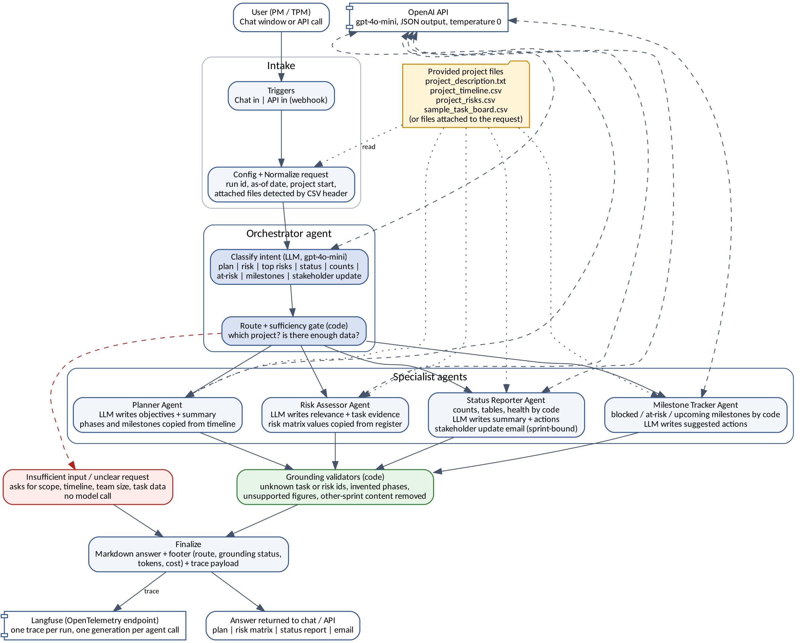

# Mira design document

Version 1.0 | 18 October 2026 | Nexora Pvt. Ltd. capstone | Status: built, offline-tested, awaiting live run with OpenAI and Langfuse keys

## 1. Purpose and scope

Mira answers 8 kinds of request from a project manager, using only the files provided (project description, timeline, risk register, task board) or files the user attaches:

| # | Request | Route | Agent(s) |
|---|---|---|---|
| 1 | Project plan | plan | Orchestrator, Planner |
| 2 | Risk assessment | risk | Orchestrator, Risk Assessor |
| 3 | Top N risks | risk | Orchestrator, Risk Assessor |
| 4 | Weekly status report (board or sprint) | status | Orchestrator, Status Reporter |
| 5 | Task counts by status | counts | Orchestrator, code only |
| 6 | Blocked, overdue or at-risk tasks | at_risk | Orchestrator, Milestone Tracker |
| 7 | Upcoming milestones | milestones | Orchestrator, code only |
| 8 | Stakeholder update email | update | Orchestrator, Status Reporter (update writer) |

Items 6 and 7 are the extended capability EX-1 (Milestone Alert System). Item 8 is EX-2 (Stakeholder Update Generator).

Out of scope: writing back to any external system, live Jira or Slack integration, user accounts, fine-tuning, retrieval over large corpora, human approval steps. These match scope document v0.5.

## 2. Design principles

1. **Code computes, the model writes.** Counts, tables, dates, task and risk lists, the health rating and milestone dates are computed by code from the files. The model returns short JSON narrative fields only.
2. **Every claim is checked.** Each model output passes a validator. Unknown task ids, risk ids, phases or milestones are dropped. Sentences with a percentage or a number of 25 or more that is not in the source are removed. Each removal is logged in the answer footer and in the trace.
3. **No data, no answer.** A sufficiency gate answers vague input (T2, T4, T6, T9) without any model call, and says exactly what is missing.
4. **Model failure degrades, never crashes.** If OpenAI returns an error or invalid JSON, the code-computed parts of the answer are still returned.
5. **Everything is traceable.** Each request produces one Langfuse trace with a span per step and a generation per model call, including tokens and cost.

## 3. Architecture

Layers:

- **Intake:** `Chat in` (n8n chat UI, file attach allowed) and `API in (webhook)` feed `Config` and `Normalize request`. Normalize creates the run context: run id, session id, as-of date, project start, attached files (recognised by CSV header).
- **Orchestration:** `Orchestrator: build prompt`, the shared `LLM call (OpenAI)`, `Restore context`, `Orchestrator: route`, `Route request`. The route node reads the model's intent. If the model fails or answers with an unknown label, rule-based keyword matching decides. It also decides which data applies (ABCDE sample files, attached or inline data, or none) and runs the sufficiency gate.
- **Specialist agents:** Planner, Risk Assessor, Status Reporter (with the update writer), Milestone Tracker. Each has a build-prompt node and a validate-and-render node.
- **Shared model call:** all 6 prompts go through the single `LLM call (OpenAI)` node. `Restore context` recovers which agent asked, and `Which agent replied?` sends the reply on.
- **Output:** `Finalize and build trace` adds the footer (route, data source, grounding status, LLM calls, tokens, cost) and builds the trace. `Tracing on?`, `Langfuse trace`, `Respond`.

## 4. Workflows

Each workflow is a path through the one n8n workflow.

### W-1 Project plan
1. Normalize: find description and timeline (ABCDE files by default).
2. Orchestrator classifies as `plan`. Sufficiency gate: description of 25 words or more, or ABCDE reference.
3. Planner prompt carries the description and the timeline phases.
4. Model returns summary, objectives with a verbatim evidence quote, scope areas, approach, governance, information gaps.
5. Validator keeps an objective only if its evidence quote exists in the description. Phases, weeks, activities and milestones are taken from the timeline file by code, not from the model. Sentences with ungrounded figures are removed.
6. Render: plan in Markdown with a phase table and an "Information not provided" list (team size, budget, owners, calendar dates).

### W-2 Risk assessment and top risks
1. Gate: needs a description or a risk register.
2. Risk prompt carries the register, the description and the task board with ids.
3. Model returns a relevance note per register risk, evidence task ids, and optional derived risks.
4. Validator drops unknown risk ids and task ids. Derived risks are shown in a separate section labelled as derived, only when they cite a real task id (decision D-04).
5. Top N: rank and reason from the model, ids checked against the register. An invalid id is replaced from the register order so the answer still has N valid risks.

### W-3 Weekly status report
1. Gate: needs a task board. Without one the answer is "No task data provided" (T6).
2. Code computes counts, task lists per status, overdue tasks, tasks due within 7 days, and the health rating.
3. Health rule: RED is 2 or more overdue open tasks, or a blocked task due within 14 days. AMBER is a blocked task, an overdue open task, or an In Progress task due within 7 days. Otherwise GREEN. The rule is printed in the answer.
4. Sprint requests list the sprint's tasks and also the board-wide blockers (decision D-08, so T024 appears in a Sprint 3 report).
5. Model returns a short summary, attention notes and next actions. Validator removes unknown task ids and ungrounded figures. No progress percentages are produced.

### W-4 Task counts
Code only. Output: Done, In progress, To do, Blocked and total, from the board. No model call after routing.

### W-5 Blocked, overdue and at-risk tasks (EX-1)
1. Code flags a task as Blocked, Overdue (due date before the as-of date, not Done) or Due soon (within 7 days, not Done).
2. The model adds a one-line suggested action per flagged task. If it fails, a fixed action text is used.
3. Output: table with ID, task, status, owner, sprint, due date, flag, reason, suggested action.

### W-6 Upcoming milestones (EX-1)
Code only. Milestones come from the timeline file. Each phase milestone falls on the Friday of the phase's end week, counted from the project start (30 March 2026). Output: table sorted by date with days from the as-of date, and a line stating how dates were set.

### W-7 Stakeholder update (EX-2)
1. Needs a sprint name and a task board. Without a sprint the answer asks which sprint (I6).
2. Only tasks of that sprint are sent to the model. Later sprints are never in the prompt.
3. Model returns subject, greeting, paragraphs, closing. Validator removes sentences with ungrounded figures and any mention of other sprints.
4. Render: email with subject, body, and a table of the sprint's tasks.
5. Audience variants (leadership, engineering, client) change tone only. Leadership is the default.

### W-8 Insufficient, unclear and failure paths
Vague input returns what is missing (scope, goals, deliverables, timeline, team size, project description) and never a plan or risk list. Unrelated input returns a short list of what Mira can do. Model errors fall back to the code-computed answer.

## 5. Agent specifications

| Agent | Receives | Returns (JSON) | Guardrails in code |
|---|---|---|---|
| Orchestrator | The request text | intent, sprint, audience, reason | Unknown intent falls back to rules; sprint taken from the text only |
| Planner | Description, timeline phases | summary, objectives with evidence, scope areas, approach, governance, gaps | Evidence quote must exist; phases and milestones from the file; figure scrub |
| Risk Assessor | Register, description, board | relevance and evidence per risk, derived risks, or top N | Ids checked against register and board; derived risks labelled |
| Status Reporter | Computed facts | summary, attention notes, next actions | Ids checked; figure scrub; counts from code |
| Update writer | One sprint's tasks | subject, greeting, paragraphs, closing | Sprint isolation; figure scrub; no other sprint mentioned |
| Milestone Tracker | Flagged tasks | suggested action per task | Ids checked; fixed text on failure |

Prompts are in `prompts/`. All use temperature 0 and JSON mode, with sections ROLE, INPUT, OUTPUT, RULES and a VAGUE INPUT RULE.

## 6. Observability and cost

Langfuse receives an OpenTelemetry trace per request: root span `mira-run` (intent, route, grounding status, cost, latency) and one child per step. Model calls are typed as generations with model, input tokens, output tokens and cost. Cost uses gpt-4o-mini list prices set in `Config` (USD 0.15 per 1M input tokens, USD 0.60 per 1M output tokens). Change them there if prices change.

A request makes 1 or 2 model calls (routing, then one specialist), and 1 call when the answer needs no specialist narrative. Expected token use per request is about 2,000 to 3,000 input and 400 to 800 output; the live figure comes from Langfuse. See `docs/EVALUATION.md`.

## 7. Assumptions and open items

| # | Assumption or item | Effect |
|---|---|---|
| A-1 | Baseline date is 24 April 2026 (end of week 4) | Overdue and due-soon results depend on it. Override with `as_of`. |
| A-2 | Project week 1 starts Monday 30 March 2026, inferred from task board due dates | Milestone dates depend on it. Override with `project_start`. |
| A-3 | The problem statement says 3 Done tasks; the board has 5 (T001 to T005) | Mira reports the board. The difference is stated in the evaluation notes. |
| A-4 | Board due dates run to 4 August 2026 (about 17 weeks); the timeline is 24 weeks | Reported as-is, not corrected. |
| A-5 | Langfuse traces use the OTLP endpoint, not the Langfuse SDK | n8n has no native Langfuse node. |
| O-1 | Live runs with OpenAI and Langfuse are done on the user's machine | The build environment cannot reach either service. |
